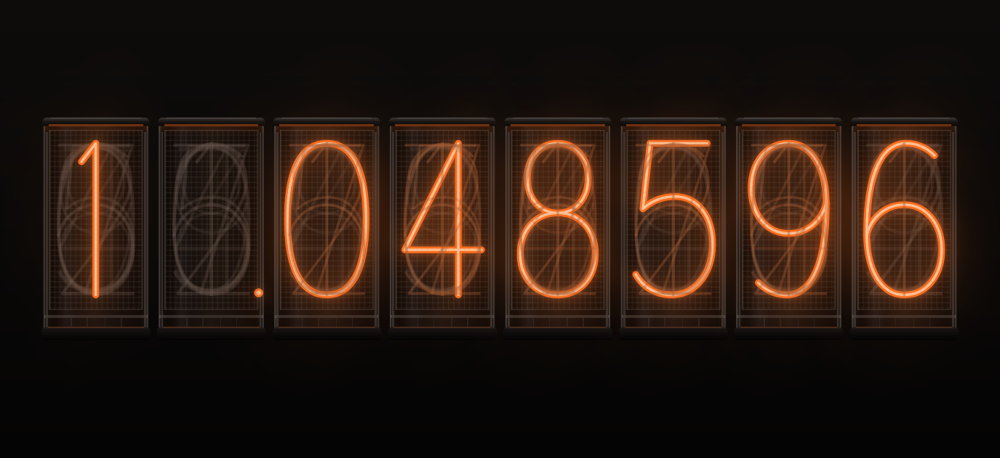

<h1 align="center">Worldline</h1>

<p align="center">
<a href="https://www.gnu.org/licenses/gpl-3.0"></a>
<a href="https://kde.org/plasma-desktop/"></a>
</p>

<p align="center">
A nixie-tube divergence meter widget for KDE Plasma 6, inspired by Steins;Gate.
Every so often it drifts to a new worldline.
</p>

<p align="center">
Please leave a ⭐ star if you like Worldline - it helps others find it :).
</p>



## Features

- Desktop or panel - the full meter on the desktop, small tubes in a panel.
- Shifts on its own every 20-60 minutes (adjustable), when clicked, and after the machine wakes from sleep.
- Settings - glow colour, glow strength, unlit digits, anode mesh.
- Drawn entirely in QML with no image assets; idle between shifts.

## Installation

Requires KDE Plasma 6.

```sh
git clone https://github.com/0xzerolight/worldline.git
cd worldline
make install
```

Then add **Worldline** from **Add Widgets**. `make uninstall` removes it.

<details>
<summary><strong>Development</strong></summary>

Needs Qt 6 dev tools (`qml-qt6 qt6-declarative-dev-tools qml6-module-qttest` on Debian/Ubuntu).

```sh
make check       # lint + tests
make preview     # design preview window
make package     # worldline.plasmoid
make screenshot  # assets/screenshot.png
```

</details>

## License

GNU General Public License v3.0 or later. See [LICENSE](LICENSE).
Steins;Gate is a trademark of its owners; this project is not affiliated with them.
