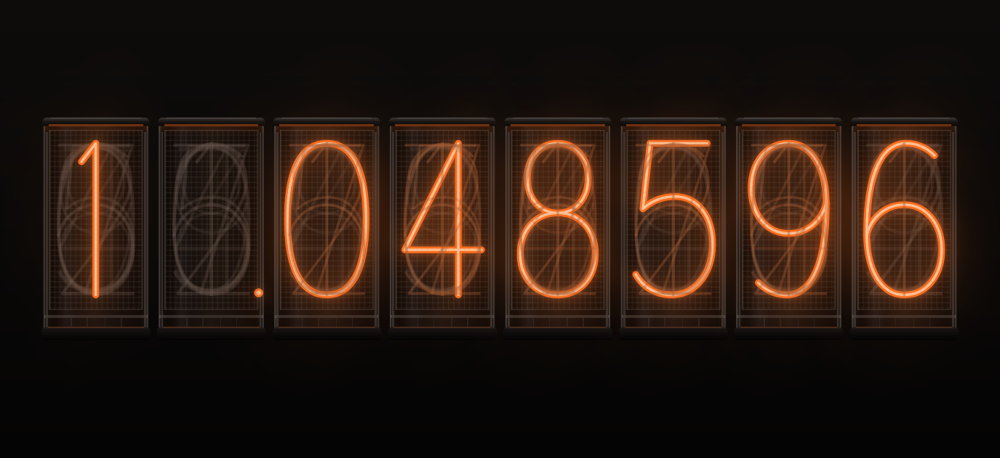

# Design

The look was settled with a throwaway prototype (three rounds, November 2026).
`make preview` opens the same meter with live controls for further tweaks.

## Tubes

- 8 tall rectangular tubes, height = 2 × width, gap 3.5 % of a tube width.
  They stand on their own: no shared base or case.
- Each tube: metal cap with an orange glint on its lower edge, flat glass walls
  with a soft broad reflection, a square anode mesh with a frame in front of the
  digits, a short lower chamber (plate, lead wires) and a small socket.
- Everything is drawn in code (`RectTube.qml`); there are no image assets.

## Digits

- Single-stroke wire paths in a 100 × 160 unit box (`Digits.js`), stretched
  15 % taller, stroke width unchanged. Not a font.
- Lit digit: neon orange `#ff6b1a` stroke with a hot core, plus a tight bloom
  and a wide halo (glow 0.7).
- Unlit cathodes are stacked front to back `1 6 2 7 5 0 4 9 8 3`. Those behind
  the lit one show faintly in grey; those in front catch a little orange.
- The decimal point has its own tube (the second one), lit at the lower right.
- At panel size (tubes under 90 px tall) the mesh, glass highlights and rods are
  dropped; under 60 px the unlit cathodes are dropped too.

## Motion

- Shift: every tube scrambles for 1.5 s, then the tubes lock in left to right,
  120 ms apart. The decimal tube never scrambles.
- Nothing animates between shifts, so the scene graph is idle (0 % CPU measured).

## Behaviour

- Drift (`Worldline.js`): small moves within the current attractor field (the
  leading digit, 0 or 1); 15 % of shifts jump to the other field; 5 % land on
  the easter egg `1.048596`.
- A shift happens after a random wait between the configured minimum and
  maximum (default 20–60 min), on click, and after waking from suspend
  (detected as a gap of more than 2 min between 30 s wall-clock ticks).
- The current value is saved in the widget config and restored on start.
- Desktop: no background frame by default (Plasma's "Show background" toggle
  can add one). Panel: small tubes with 15 % of the panel thickness as padding
  on every side, so they sit at the size of the icons and clock next to them;
  click opens the big meter in a popup.
